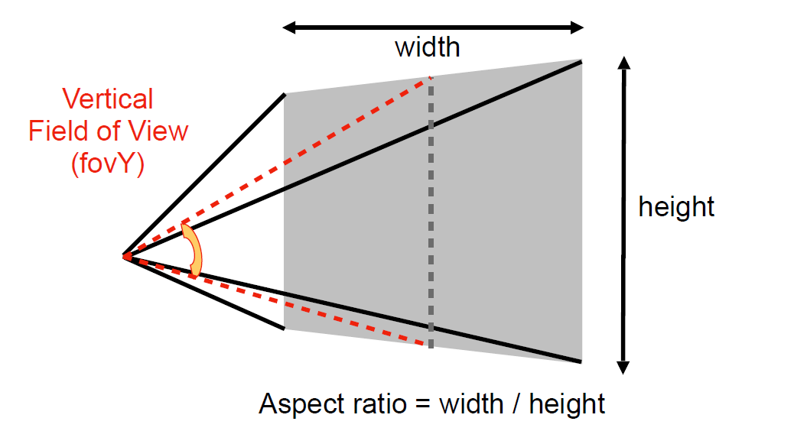
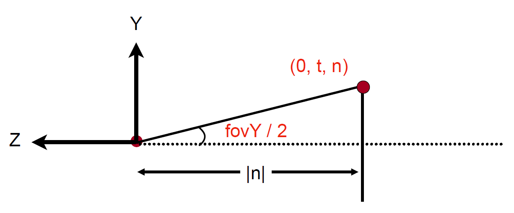
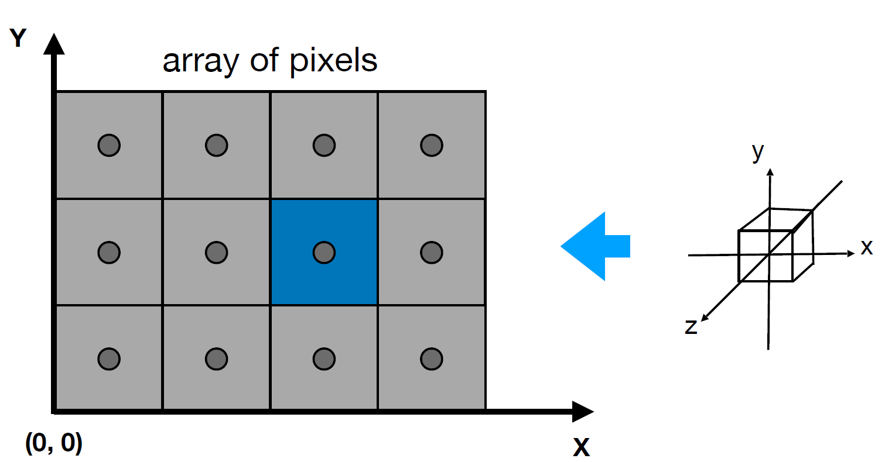
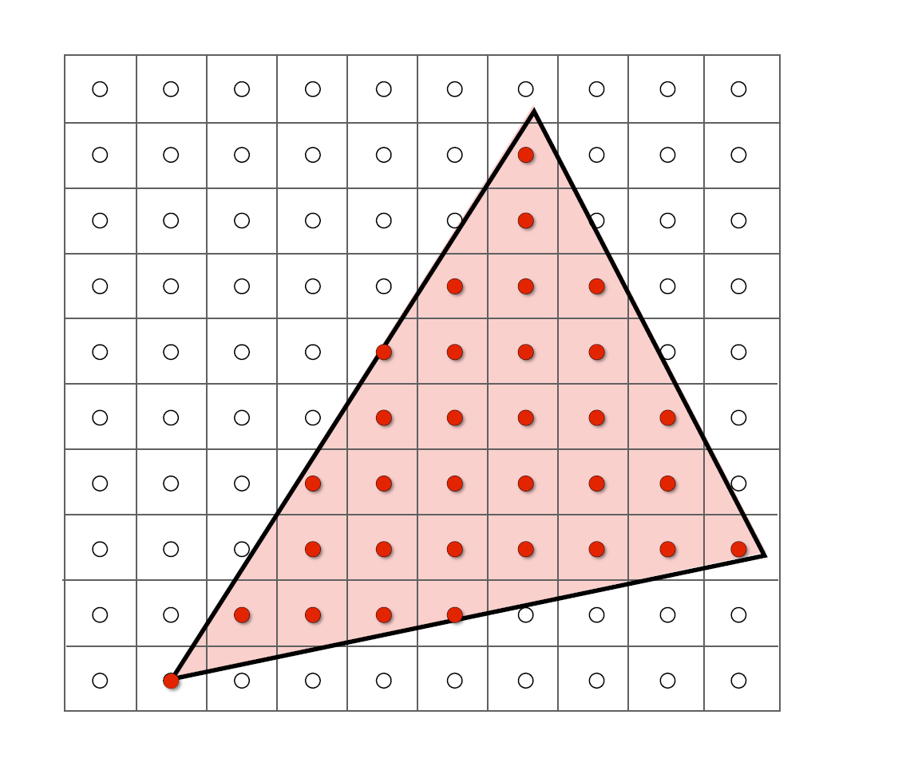
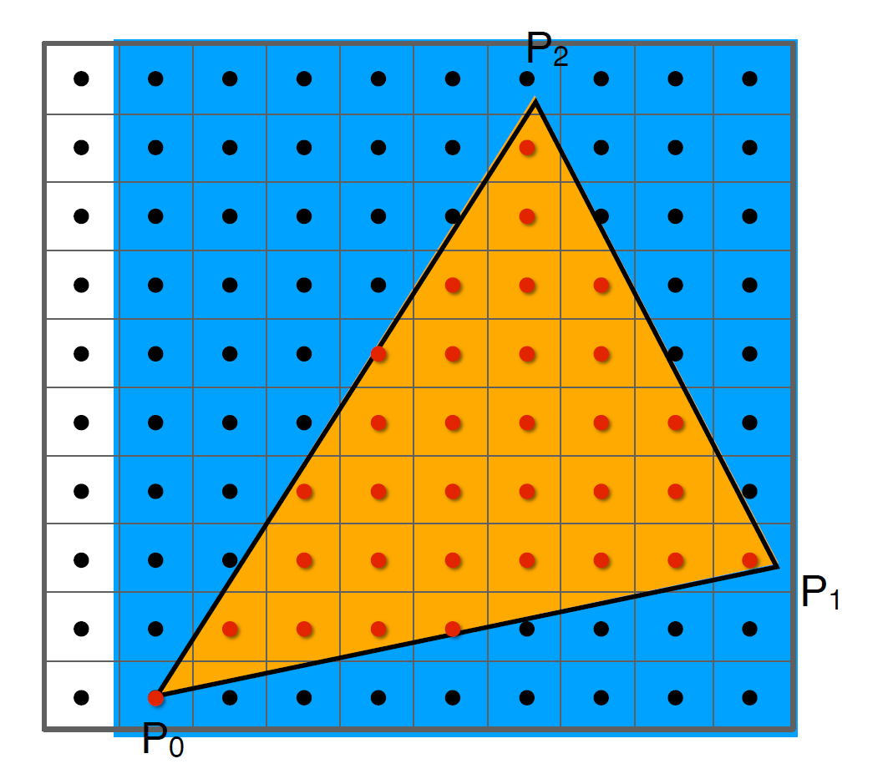

# Rasterization

我们已知如何将三维物体变换到规范立方体中，但是计算机屏幕的显示是离散的并没办法显示连续的几何图形。而光栅化（Rasterization）就是将连续的几何图形转换成离散的屏幕采样的过程。

## FOV和宽高比

我们之前使用$l,r,t,b,n,f$来定义一个视锥体，但是实际使用中我们一般使用FOV(Field of View)和aspect（宽高比）来定义相机的透视投影。

FOV定义的是相机的视野，以上图所示fovY表示的就是相机的垂直视野，aspect定义的是屏幕的宽高比。根据上图关系，我们可以很轻松列出此情况下的FOV和aspect：
$$
\begin{aligned}
\tan \frac{fovY}{2} &= \frac{t}{|n|} \cr
aspect &= \frac{r}{t}
\end{aligned}
$$

## Viewport Transformation

我们之前通过变换已经将观察空间变为标准立方体了，但是屏幕的视口与标准立方体并不同，故我们需要将标准立方体的$xy$平面$[-1,1]^2$变到与屏幕$[0,width] \times [0,height]$一样。显然这里我们只需要将原正方形平面做一个线性变换加上平移就可，综合两步可以写出以下转换矩阵：
$$
M_{viewport}=TS=
\begin{bmatrix}
\frac{width}{2} & 0 & 0 & \frac{width}{2} \cr
0 & \frac{height}{2} & 0 & \frac{height}{2} \cr
0 & 0 & 1 & 0 \cr
0 & 0 & 0 & 1
\end{bmatrix}
$$

## Sampling

接下来我们需要处理如何具体将连续的几何图形转换成离散的。在此之前需要先明确几件事：

- 光栅化时我们一般使用三角形，因为三角形是最简单的非退化多边形，也方便之后判断具体点与三角形的位置关系
- 一般使用像素中心来进行采样，即若此像素索引为$(x,y)$那么我们使用$(x+0.5,y+0.5)$这个像素中心来表示像素位置

明确之后我们开始具体执行。我们可以采用采样的方式来确定到底需要使用哪些像素来表示几何图形。具体执行过程就是扫描整个屏幕空间，判断所选像素是否在目标几何图形之内，若是则使用$1$表示，否则使用$0$表示，最终可以选出需要的具体像素。对于具体如何判断该点是否在三角形内，我们可以使用前面所知的向量叉乘的方法，若该点与三角形三个点所构成的向量以及三条边的叉乘的方向一样，那么即认为该点在三角形内。

如上图所示即是经过采样后效果，使用红色表示需要利用该像素点来表示此三角形。

我们发现难免有些点在有时候会出现在三角形的边上，无法认定是否在三角形内，一般我们对这些点不做处理，若有特殊需要也可以做特殊处理。

## Bounding Box

如果我们的三角形只占屏幕中的很小一部分，那么我们扫描整个屏幕就会显得浪费，此时我们可以引入AABB（Axis-Aligned Bounding Box 轴对齐包围盒）。我们只需要扫描刚好包围这个三角形的区域即可。

