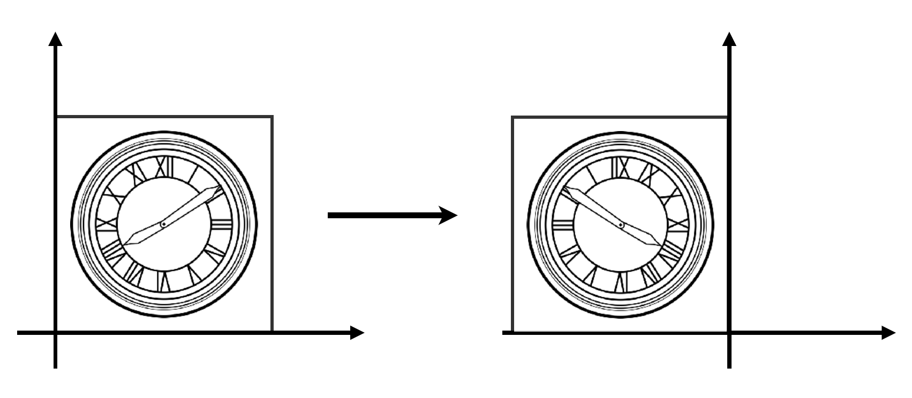
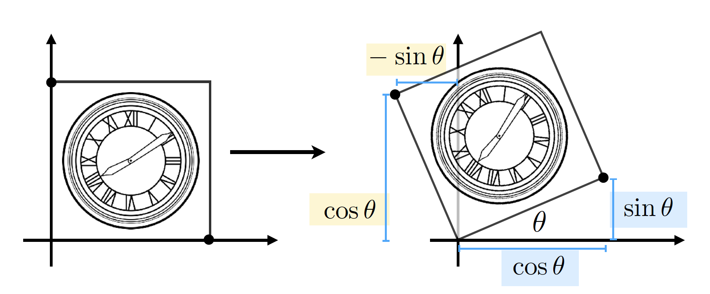
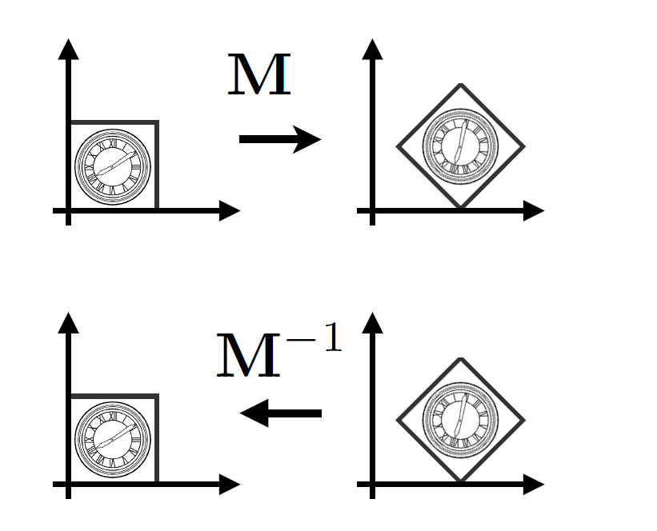
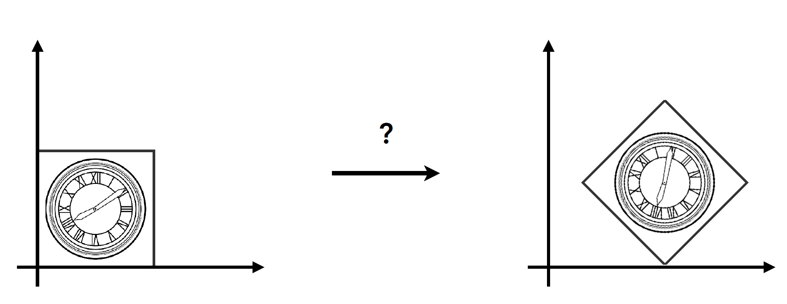
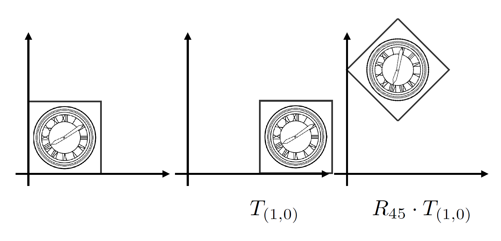
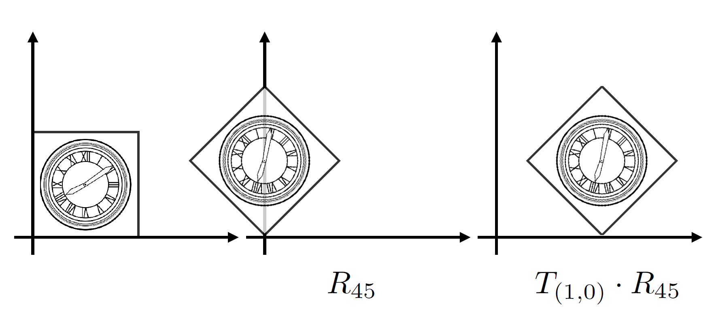

# Transformation

此讲主要讲述transformation相关的知识，讲述了不同变换，例如缩放、旋转、平移等在数学上是如何做的，是如何寻找前后图形之间的关系并写出对应的方程

## 缩放

顾名思义就是对原先的图形进行放大或者缩小。

对于缩放前后的图形我们不难发现两者的对应点的坐标存在一定的关系。若我们将变换前的坐标设为$(x,y)$且将缩放的倍数定义为$s$，则可以不难发现缩放之后原先对应点的坐标$(x',y')$与原坐标存在如下关系：

$$
\begin{aligned}
x' &= sx \cr
y' &= sy
\end{aligned}
$$

如果我们通过矩阵的形式将坐标列出来，还存在如下的关系：

$$
\begin{bmatrix}
x' \cr
y'
\end{bmatrix} =
\begin{bmatrix}
s & 0 \cr
0 & s
\end{bmatrix}
\begin{bmatrix}
x \cr
y
\end{bmatrix}
$$

如果在$x$轴与$y$轴上我们变换是不统一的，即各自有各自的变换倍率，那么我们这个公式还可以进一步扩展为：

$$
\begin{bmatrix}
x' \cr
y'
\end{bmatrix} =
\begin{bmatrix}
s_x & 0 \cr
0 & s_y
\end{bmatrix}
\begin{bmatrix}
x \cr
y
\end{bmatrix}
$$

## 镜像

镜像操作简单来说就是以某一轴将图片进行镜像。

以上图的镜像操作为例。上图将图片以$y$轴做了镜像。简单观察原坐标与现坐标的关系可以得知，仅在$x$轴上进行了取反的操作，$y$轴的坐标并没有改变，所以对于这个变换我们直接将$x$坐标的值进行取反即可，可以得到以下关系：

$$
\begin{bmatrix}
x' \cr
y'
\end{bmatrix} =
\begin{bmatrix}
-1 & 0 \cr
0 & 1 \cr
\end{bmatrix}
\begin{bmatrix}
x \cr
y
\end{bmatrix}
$$

## 切变

切变操作就是使一个图形沿某个方向倾斜，但是不改变面积。比如将一个矩形推成平行四边形。

如图，图中对一个正方形进行切变操作使其变成一个平行四边形。我们随意选取原图中的某个点并找到其操作后对应的点，可以发现对于$y$轴，其未进行任何变换依旧保持原值，但$x$轴上的点进行了较大变化，而且随着$y$值的增大$x$值向正方向移动的值越大。若我们设在$y$值等于1的地方$x$值向正方向移动了$a$的话，那么$x$值的变化规律可以写为$x'=x+ay$。综合以上的规律我们最终可以写出此切变操作的关系式：

$$
\begin{bmatrix}
x' \cr
y'
\end{bmatrix} =
\begin{bmatrix}
1 & a \cr
0 & 1
\end{bmatrix}
\begin{bmatrix}
x \cr
y
\end{bmatrix}
$$

## 旋转

旋转操作就是将图形沿一固定点（默认原点）旋转一定角度$\theta$

以图片为例，图中将图形沿原点旋转了$\theta$角度，我们观察图中的点都进行了什么变化。

首先看右边蓝色注释的点，其原来的坐标为$(1,0)$，旋转后得到的坐标为$(\cos \theta , \sin \theta)$。若我们设此旋转操作满足以下关系：

$$
\begin{bmatrix}
x' \cr
y'
\end{bmatrix} =
\begin{bmatrix}
a & b\cr
c & d
\end{bmatrix}
\begin{bmatrix}
x \cr
y
\end{bmatrix}
$$

对于此点可以列出方程：

$$
\begin{bmatrix}
\cos \theta \cr
\sin \theta
\end{bmatrix} =
\begin{bmatrix}
a & b\cr
c & d
\end{bmatrix}
\begin{bmatrix}
1 \cr
0
\end{bmatrix}
$$

可以列出等式关系：

$$
\begin{cases}
\cos \theta = a \times 1 + b\times0 \cr
\sin \theta = c \times 1 + d \times 0
\end{cases}
$$

解得：$a=\cos \theta, c=\sin \theta$

同理我们对左侧黄色注释的点进行同样的求解操作，可以得到：$b=-\sin \theta, d=\cos \theta$

所以最终我们可以得到这个旋转满足以下关系：

$$
\begin{bmatrix}
x' \cr
y'
\end{bmatrix} =
\begin{bmatrix}
\cos \theta & -\sin \theta\cr
\sin \theta & \cos \theta
\end{bmatrix}
\begin{bmatrix}
x \cr
y
\end{bmatrix}
$$

## 线性变换

简单来说满足如下式子的变换我们可以称之为线性变换。

$$
\begin{aligned}
x' &= ax+by \cr
y' &= cx+dy
\end{aligned}
$$

$$
\begin{bmatrix}
x' \cr
y'
\end{bmatrix} =
\begin{bmatrix}
a & b\cr
c & d
\end{bmatrix}
\begin{bmatrix}
x \cr
y
\end{bmatrix}
$$

## 平移

平移操作就是对图形在坐标轴上的移动，且改变其位置

如图，对图片进行了平移操作，将其位于原点的点移动到$(tx,ty)$。不难看出此操作满足如下关系：

$$
\begin{aligned}
x' &= x+t_x\cr
y' &= y+t_y
\end{aligned}
$$

如果将上面的关系写成矩阵形式那么则变为：

$$
\begin{bmatrix}
x' \cr
y'
\end{bmatrix} =
\begin{bmatrix}
1 & 0\cr
0 & 1
\end{bmatrix}
\begin{bmatrix}
x \cr
y
\end{bmatrix} +
\begin{bmatrix}
t_x \cr
t_y
\end{bmatrix}
$$

但是我们发现这样写存在一定问题，这并不满足线性变换，我们需要把这个式子变为满足线性变换的式子。

不难发现，原式子可以写为：

$$
\begin{bmatrix}
x' \cr
y'
\end{bmatrix} =
\begin{bmatrix}
1 & 0\cr
0 & 1
\end{bmatrix}
\begin{bmatrix}
x \cr
y
\end{bmatrix} +
\begin{bmatrix}
t_x \cr
t_y
\end{bmatrix} \cdot 1
$$

利用分块矩阵的性质，可以将右边的式子改写为：

$$
\begin{bmatrix}
1 & 0 & t_x \cr
0 & 1 & t_y
\end{bmatrix}
\begin{bmatrix}
x \cr
y \cr
1
\end{bmatrix}
$$

为保证输入输出均为三分量的齐次坐标，我们可以对该式子进行一点变换，最终得到满足此平移且满足线性变换的关系式子：

$$
\begin{bmatrix}
x' \cr
y' \cr
1
\end{bmatrix} =
\begin{bmatrix}
1 & 0 & t_x \cr
0 & 1 & t_y \cr
0 & 0 & 1
\end{bmatrix}
\begin{bmatrix}
x \cr
y \cr
1
\end{bmatrix}
$$

上面说的“满足线性变换”，具体指的是可以在齐次坐标下用 $3\times3$ 矩阵乘法表示平移。回到原来的二维坐标，非零平移会把原点移到 $(t_x,t_y)$，因此它属于仿射变换。这里把点的齐次分量取为 $w=1$，把方向向量的齐次分量取为 $w=0$，所以平移项只对点生效。

## 逆变换

若我们对一个图形做了$M$变换，那么我们只需要对这个图形再做一遍逆变换这个图形就会恢复原状。具体逆变换的方法是左乘原变换的逆矩阵，即$M^{-1}$。

这里有一个前提，$M$ 必须可逆。用列向量表示变换前后的坐标，若 $\mathbf{p}'=M\mathbf{p}$，就可以用 $\mathbf{p}=M^{-1}\mathbf{p}'$ 恢复原坐标。比如把 $x$ 方向的缩放倍数设为 $0$，所有点的 $x$ 坐标都会变成 $0$，原来的 $x$ 坐标也就无法恢复了。

## 复杂变换

有时我们无法通过前面已知的一些简单变换一步直接的得到最终图形，例如下图所示

这时候我们需要将这个复杂的变换拆成一个个基础变换

如果我们先对原图形进行平移操作再旋转就会得到上图所示的结果，发现并没有达到我们预期的状态。

若我们对原图像先进行旋转操作再进行平移操作，可以发现最终图像达到了我们预期的状态。

虽然两次操作的基本操作都是一样的，都是逆时针旋转了45度以及平移到$(1,0)$。但是最后的效果确实不同的，可见对于复杂变换，其基础操作的执行顺序非常重要，因为**矩阵不满足交换律**。

如我们需要写出满足上述操作关系的式子，我们可以按照先左乘最先做的操作，再左乘下一步操作，例如上述先旋转再平移的操作可以写为：

$$
T_{(1,0)} \cdot R_{(45)}
\begin{bmatrix}
x \cr
y \cr
1
\end{bmatrix} =
\begin{bmatrix}
1 & 0 & 1 \cr
0 & 1 & 0 \cr
0 & 0 & 1
\end{bmatrix}
\begin{bmatrix}
\cos 45^\circ & -\sin 45^\circ & 0 \cr
\sin 45^\circ & \cos 45^\circ & 0 \cr
0 & 0 & 1
\end{bmatrix}
\begin{bmatrix}
x \cr
y \cr
1
\end{bmatrix}
$$

事实上由于矩阵满足结合律，对于复杂变换的所有操作最终可以变为一个操作。例如上述变换最终就可以变换成如下形式：

$$
\begin{bmatrix}
\cos 45^\circ & -\sin 45^\circ & 1 \cr
\sin 45^\circ & \cos 45^\circ & 0 \cr
0 & 0 & 1
\end{bmatrix}
$$

观察上述式子，我们最终可以发现另一个规律。形如：

$$
\begin{bmatrix}
a & b & t_x \cr
c & d & t_y \cr
0 & 0 & 1
\end{bmatrix}
$$

的式子，最终的执行顺序都是先进行线性变换，再进行仿射变换。嘻嘻

这里更准确地说，是先做线性变换，再做平移。设矩阵左上角的 $2\times2$ 子矩阵为 $A$，最右列的前两个分量组成平移向量 $\mathbf{t}$。对于二维点 $\mathbf{p}$，先算 $A\mathbf{p}$，再加上 $\mathbf{t}$，得到 $\mathbf{p}'=A\mathbf{p}+\mathbf{t}$。整个映射就是仿射变换。

## 3D Transformation

三维状态下的变换其情况与二维状态下的类似，我们只需要加一维，利用$4\times4$的矩阵来表示就行了

$$
\begin{bmatrix}
a & b & c & t_x \cr
d & e & f & t_y \cr
g & h & i & t_z \cr
0 & 0 & 0 & 1
\end{bmatrix}
$$
