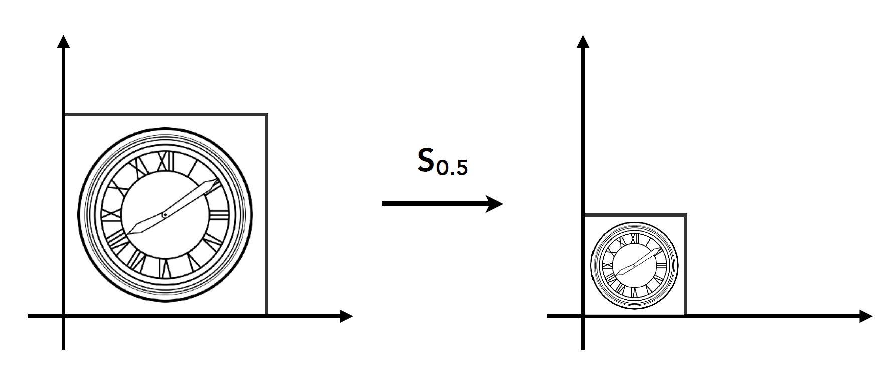
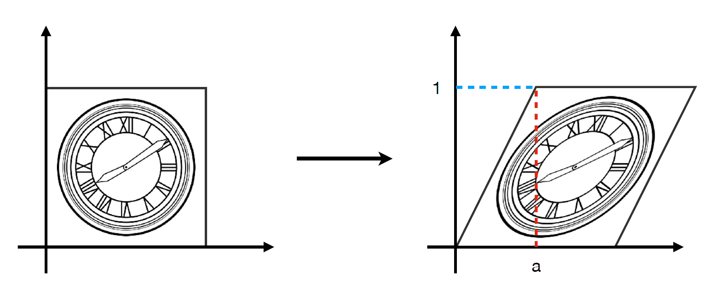
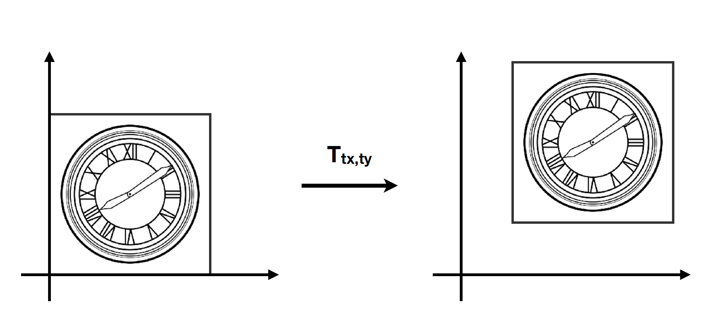
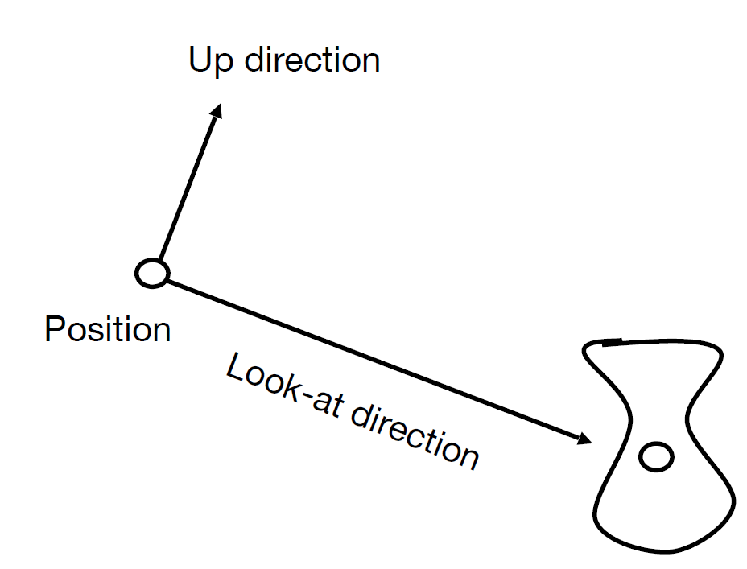
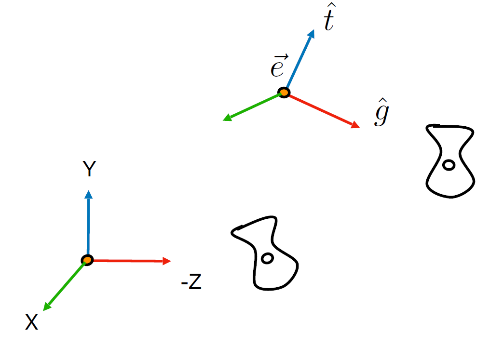
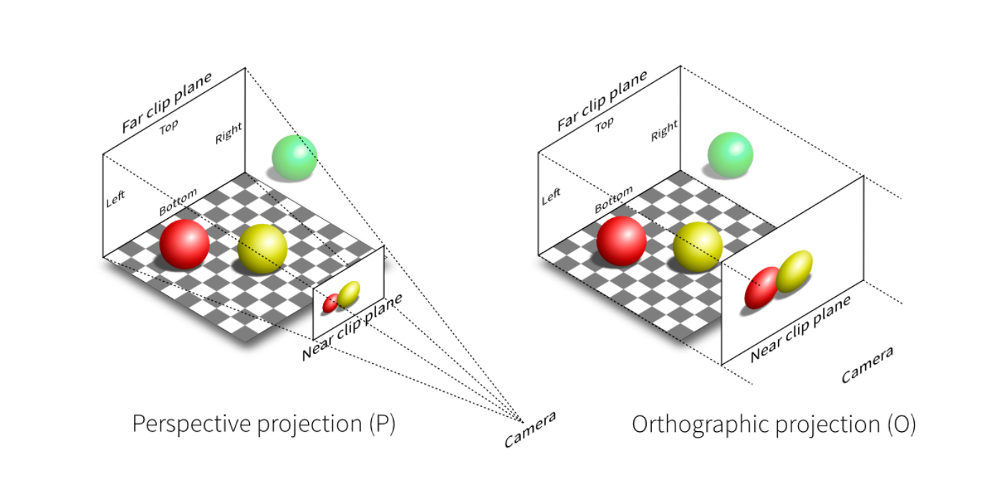
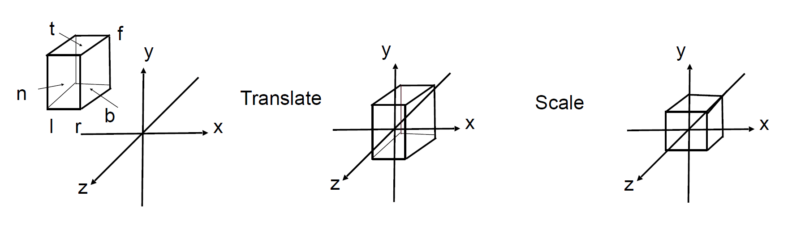
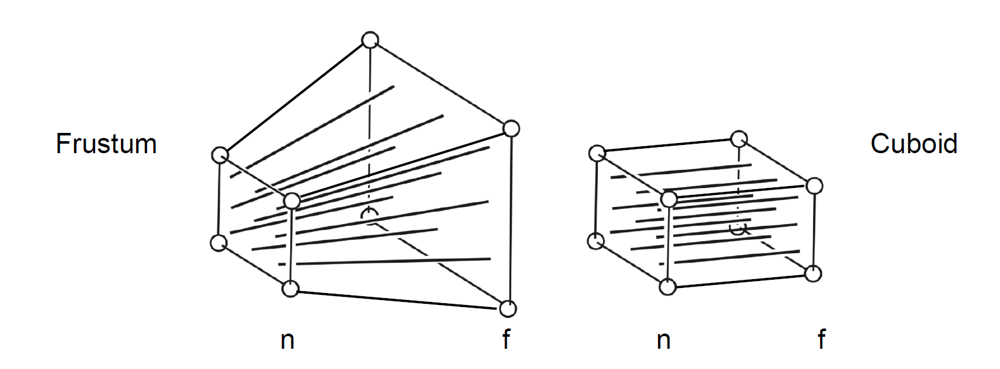
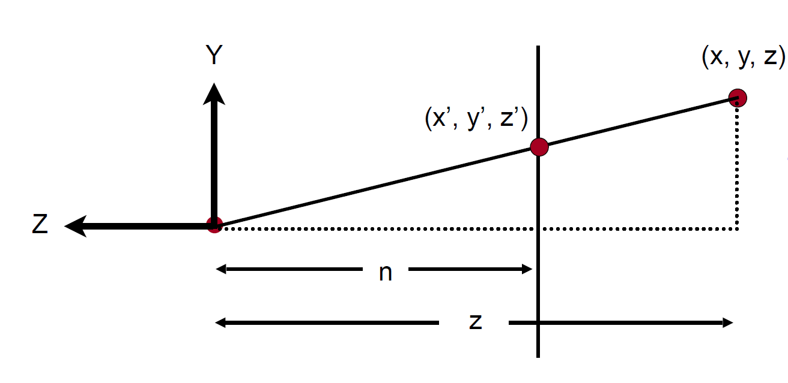

# Transformation

此讲主要讲述transformation相关的知识，讲述了不同变换，例如缩放、旋转、平移等在数学上是如何做的，是如何寻找前后图形之间的关系并写出对应的方程

## 缩放

顾名思义就是对原先的图形进行放大或者缩小。

对于缩放前后的图形我们不难发现两者的对应点的坐标存在一定的关系。若我们将变换前的坐标设为$(x,y)$且将缩放的倍数定义为$s$，则可以不难发现缩放之后原先对应点的坐标$(x',y')$与原坐标存在如下关系：

$$
\begin{aligned}
x' &= sx \cr
y' &= sy
\end{aligned}
$$

如果我们通过矩阵的形式将坐标列出来，还存在如下的关系：

$$
\begin{bmatrix}
x' \cr
y'
\end{bmatrix} =
\begin{bmatrix}
s & 0 \cr
0 & s
\end{bmatrix}
\begin{bmatrix}
x \cr
y
\end{bmatrix}
$$

如果在$x$轴与$y$轴上我们变换是不统一的，即各自有各自的变换倍率，那么我们这个公式还可以进一步扩展为：

$$
\begin{bmatrix}
x' \cr
y'
\end{bmatrix} =
\begin{bmatrix}
s_x & 0 \cr
0 & s_y
\end{bmatrix}
\begin{bmatrix}
x \cr
y
\end{bmatrix}
$$

## 镜像

镜像操作简单来说就是以某一轴将图片进行镜像。

以上图的镜像操作为例。上图将图片以$y$轴做了镜像。简单观察原坐标与现坐标的关系可以得知，仅在$x$轴上进行了取反的操作，$y$轴的坐标并没有改变，所以对于这个变换我们直接将$x$坐标的值进行取反即可，可以得到以下关系：

$$
\begin{bmatrix}
x' \cr
y'
\end{bmatrix} =
\begin{bmatrix}
-1 & 0 \cr
0 & 1 \cr
\end{bmatrix}
\begin{bmatrix}
x \cr
y
\end{bmatrix}
$$

## 切变

切变操作就是使一个图形沿某个方向倾斜，但是不改变面积。比如将一个矩形推成平行四边形。

如图，图中对一个正方形进行切变操作使其变成一个平行四边形。我们随意选取原图中的某个点并找到其操作后对应的点，可以发现对于$y$轴，其未进行任何变换依旧保持原值，但$x$轴上的点进行了较大变化，而且随着$y$值的增大$x$值向正方向移动的值越大。若我们设在$y$值等于1的地方$x$值向正方向移动了$a$的话，那么$x$值的变化规律可以写为$x'=x+ay$。综合以上的规律我们最终可以写出此切变操作的关系式：

$$
\begin{bmatrix}
x' \cr
y'
\end{bmatrix} =
\begin{bmatrix}
1 & a \cr
0 & 1
\end{bmatrix}
\begin{bmatrix}
x \cr
y
\end{bmatrix}
$$

## 旋转

旋转操作就是将图形沿一固定点（默认原点）旋转一定角度$\theta$

以图片为例，图中将图形沿原点旋转了$\theta$角度，我们观察图中的点都进行了什么变化。

首先看右边蓝色注释的点，其原来的坐标为$(1,0)$，旋转后得到的坐标为$(\cos \theta , \sin \theta)$。若我们设此旋转操作满足以下关系：

$$
\begin{bmatrix}
x' \cr
y'
\end{bmatrix} =
\begin{bmatrix}
a & b\cr
c & d
\end{bmatrix}
\begin{bmatrix}
x \cr
y
\end{bmatrix}
$$

对于此点可以列出方程：

$$
\begin{bmatrix}
\cos \theta \cr
\sin \theta
\end{bmatrix} =
\begin{bmatrix}
a & b\cr
c & d
\end{bmatrix}
\begin{bmatrix}
1 \cr
0
\end{bmatrix}
$$

可以列出等式关系：

$$
\begin{cases}
\cos \theta = a \times 1 + b\times0 \cr
\sin \theta = c \times 1 + d \times 0
\end{cases}
$$

解得：$a=\cos \theta, c=\sin \theta$

同理我们对左侧黄色注释的点进行同样的求解操作，可以得到：$b=-\sin \theta, d=\cos \theta$

所以最终我们可以得到这个旋转满足以下关系：

$$
\begin{bmatrix}
x' \cr
y'
\end{bmatrix} =
\begin{bmatrix}
\cos \theta & -\sin \theta\cr
\sin \theta & \cos \theta
\end{bmatrix}
\begin{bmatrix}
x \cr
y
\end{bmatrix}
$$

## 线性变换

简单来说满足如下式子的变换我们可以称之为线性变换。

$$
\begin{aligned}
x' &= ax+by \cr
y' &= cx+dy
\end{aligned}
$$

$$
\begin{bmatrix}
x' \cr
y'
\end{bmatrix} =
\begin{bmatrix}
a & b\cr
c & d
\end{bmatrix}
\begin{bmatrix}
x \cr
y
\end{bmatrix}
$$

## 平移

平移操作就是对图形在坐标轴上的移动，且改变其位置

如图，对图片进行了平移操作，将其位于原点的点移动到$(tx,ty)$。不难看出此操作满足如下关系：

$$
\begin{aligned}
x' &= x+t_x\cr
y' &= y+t_y
\end{aligned}
$$

如果将上面的关系写成矩阵形式那么则变为：

$$
\begin{bmatrix}
x' \cr
y'
\end{bmatrix} =
\begin{bmatrix}
1 & 0\cr
0 & 1
\end{bmatrix}
\begin{bmatrix}
x \cr
y
\end{bmatrix} +
\begin{bmatrix}
t_x \cr
t_y
\end{bmatrix}
$$

但是我们发现这样写存在一定问题，这并不满足线性变换，我们需要把这个式子变为满足线性变换的式子。

不难发现，原式子可以写为：

$$
\begin{bmatrix}
x' \cr
y'
\end{bmatrix} =
\begin{bmatrix}
1 & 0\cr
0 & 1
\end{bmatrix}
\begin{bmatrix}
x \cr
y
\end{bmatrix} +
\begin{bmatrix}
t_x \cr
t_y
\end{bmatrix} \cdot 1
$$

利用分块矩阵的性质，可以将右边的式子改写为：

$$
\begin{bmatrix}
1 & 0 & t_x \cr
0 & 1 & t_y
\end{bmatrix}
\begin{bmatrix}
x \cr
y \cr
1
\end{bmatrix}
$$

为保证输入输出均为三分量的齐次坐标，我们可以对该式子进行一点变换，最终得到满足此平移且满足线性变换的关系式子：

$$
\begin{bmatrix}
x' \cr
y' \cr
1
\end{bmatrix} =
\begin{bmatrix}
1 & 0 & t_x \cr
0 & 1 & t_y \cr
0 & 0 & 1
\end{bmatrix}
\begin{bmatrix}
x \cr
y \cr
1
\end{bmatrix}
$$

上面说的“满足线性变换”，具体指的是可以在齐次坐标下用 $3\times3$ 矩阵乘法表示平移。回到原来的二维坐标，非零平移会把原点移到 $(t_x,t_y)$，因此它属于仿射变换。这里把点的齐次分量取为 $w=1$，把方向向量的齐次分量取为 $w=0$，所以平移项只对点生效。

## 逆变换

若我们对一个图形做了$M$变换，那么我们只需要对这个图形再做一遍逆变换这个图形就会恢复原状。具体逆变换的方法是左乘原变换的逆矩阵，即$M^{-1}$。

这里有一个前提，$M$ 必须可逆。用列向量表示变换前后的坐标，若 $\mathbf{p}'=M\mathbf{p}$，就可以用 $\mathbf{p}=M^{-1}\mathbf{p}'$ 恢复原坐标。比如把 $x$ 方向的缩放倍数设为 $0$，所有点的 $x$ 坐标都会变成 $0$，原来的 $x$ 坐标也就无法恢复了。

## 复杂变换

有时我们无法通过前面已知的一些简单变换一步直接的得到最终图形，例如下图所示

这时候我们需要将这个复杂的变换拆成一个个基础变换

如果我们先对原图形进行平移操作再旋转就会得到上图所示的结果，发现并没有达到我们预期的状态。

若我们对原图像先进行旋转操作再进行平移操作，可以发现最终图像达到了我们预期的状态。

虽然两次操作的基本操作都是一样的，都是逆时针旋转了45度以及平移到$(1,0)$。但是最后的效果确实不同的，可见对于复杂变换，其基础操作的执行顺序非常重要，因为**矩阵不满足交换律**。

如我们需要写出满足上述操作关系的式子，我们可以按照先左乘最先做的操作，再左乘下一步操作，例如上述先旋转再平移的操作可以写为：

$$
T_{(1,0)} \cdot R_{(45)}
\begin{bmatrix}
x \cr
y \cr
1
\end{bmatrix} =
\begin{bmatrix}
1 & 0 & 1 \cr
0 & 1 & 0 \cr
0 & 0 & 1
\end{bmatrix}
\begin{bmatrix}
\cos 45^\circ & -\sin 45^\circ & 0 \cr
\sin 45^\circ & \cos 45^\circ & 0 \cr
0 & 0 & 1
\end{bmatrix}
\begin{bmatrix}
x \cr
y \cr
1
\end{bmatrix}
$$

事实上由于矩阵满足结合律，对于复杂变换的所有操作最终可以变为一个操作。例如上述变换最终就可以变换成如下形式：

$$
\begin{bmatrix}
\cos 45^\circ & -\sin 45^\circ & 1 \cr
\sin 45^\circ & \cos 45^\circ & 0 \cr
0 & 0 & 1
\end{bmatrix}
$$

观察上述式子，我们最终可以发现另一个规律。形如：

$$
\begin{bmatrix}
a & b & t_x \cr
c & d & t_y \cr
0 & 0 & 1
\end{bmatrix}
$$

的式子，最终的执行顺序都是先进行线性变换，再进行仿射变换。嘻嘻

这里更准确地说，是先做线性变换，再做平移。设矩阵左上角的 $2\times2$ 子矩阵为 $A$，最右列的前两个分量组成平移向量 $\mathbf{t}$。对于二维点 $\mathbf{p}$，先算 $A\mathbf{p}$，再加上 $\mathbf{t}$，得到 $\mathbf{p}'=A\mathbf{p}+\mathbf{t}$。整个映射就是仿射变换。

## 3D Transformation

三维状态下的变换其情况与二维状态下的类似，我们只需要加一维，利用$4\times4$的矩阵来表示就行了

$$
\begin{bmatrix}
a & b & c & t_x \cr
d & e & f & t_y \cr
g & h & i & t_z \cr
0 & 0 & 0 & 1
\end{bmatrix}
$$

### 旋转

在三维情况下的旋转整体上与二维的类似。围绕某一坐标轴旋转本质上就是在垂直于该坐标轴的平面上做二维旋转，因而可以得到以下式子：

$$
\begin{aligned}
R_x(\alpha) &=
\begin{bmatrix}
1 & 0 & 0 & 0 \cr
0 & \cos \alpha & -\sin \alpha & 0 \cr
0 & \sin \alpha & \cos \alpha & 0 \cr
0 & 0 & 0 & 1
\end{bmatrix}
\cr
R_y(\alpha) &=
\begin{bmatrix}
\cos \alpha & 0 & \sin \alpha & 0 \cr
0 & 1 & 0 & 0 \cr
-\sin \alpha & 0 & \cos \alpha & 0 \cr
0 & 0 & 0 & 1
\end{bmatrix}
\cr
R_z(\alpha) &=
\begin{bmatrix}
\cos \alpha & -\sin \alpha & 0 & 0 \cr
\sin \alpha & \cos \alpha & 0 & 0 \cr
0 & 0 & 1 & 0 \cr
0 & 0 & 0 & 1
\end{bmatrix}
\end{aligned}
$$

观察上面式子，我们尤其需要注意对于绕$y$轴旋转的情况，不能简单的照搬二维旋转的公式，而是要对其做一个转置。这是由于在三维旋转中我们要保证正旋转角度都是以右手系为标准的。对于$y$轴其正向旋转方向为$z \to x$，故列出其二维旋转公式：

$$
\begin{bmatrix}
z' \cr
x'
\end{bmatrix} =
\begin{bmatrix}
\cos \alpha & -\sin \alpha \cr
\sin \alpha & \cos \alpha
\end{bmatrix}
\begin{bmatrix}
z \cr
x
\end{bmatrix}
$$

$$
\begin{cases}
z'=z\cos \alpha - x \sin \alpha \cr
x'=z \sin \alpha + x \cos \alpha
\end{cases}
$$

我们再对以上式子进行一个简单的整理：

$$
\begin{cases}
x'= x \cos \alpha + z \sin \alpha \cr
y'=y \cr
z'= -x \sin \alpha + z \cos \alpha
\end{cases}
$$

最终将其化为矩阵形式就可以得到$R_y(\alpha)$。

### 罗德里格斯旋转公式

我们现在已知在三维空间中让物体围绕一固定的坐标轴旋转的公式，但仍不知围绕任意一直线旋转的公式是如何的。而罗德里格斯公式将旋转公式推广到了**任意旋转轴**。

假设旋转轴的单位方向向量为：

$$
n=
\begin{bmatrix}
n_x \cr
n_y \cr
n_z
\end{bmatrix},\quad \| \mathbf{n} \| =1
$$

且旋转角度为$\alpha$，那么我们可以得到以下罗德里格斯公式：

$$
R(n,\alpha)=\cos \alpha I + (1-\cos \alpha) \mathbf{n} \mathbf{n}^{T} + \sin \alpha N
$$

其中：

- $I$：三阶单位矩阵。

- $\mathbf{n} \mathbf{n}^{T}$：旋转轴单位向量与其转置的外积。
- $N$：由旋转向量构成的反对称矩阵。

$$
N =
\begin{bmatrix}
0 & -n_z & n_y \cr
n_z & 0 & -n_x \cr
-n_y & n_x & 0
\end{bmatrix}
$$

在这个公式中有一点需要我们注意，对于同一方向向量我们可以得到许多旋转轴，这里我们同时默认使用过原点的旋转轴，即方向向量的起点是原点。

## View Transformation

对于三维世界中的一个物体，我们可以使用一个相机去观察它。那么如何定义一个相机，其包含什么参数呢？

- 相机位置：$\mathbf{e}$
- 向上方向：$\hat{t}$
- 观察方向：$\hat{g}$

下面默认 $\hat{g}$ 和 $\hat{t}$ 都是单位向量，而且互相垂直。这样 $\hat{g}\times\hat{t}$、$\hat{t}$ 和 $-\hat{g}$ 就构成一组正交归一的相机基，后面求逆时才可以直接转置。如果实际给定的是一个与观察方向不共线的参考向上方向 $\mathbf{u}$，可以先将 $\hat{g}\times\mathbf{u}$ 归一化得到右方向 $\mathbf{r}$，再用 $\mathbf{r}\times\hat{g}$ 得到这里的 $\hat{t}$。

显然我们的相机可以处于世界中的任意位置，但是这样并不方便，因为相机坐标和世界坐标并不重合。我们发现，只要相机与其所看的物体之间的相对位置并没有发生改变，那么相机最终所照出来的最终效果也并不会改变，因而我们可以考虑对相机的视角进行转换使其与世界坐标相重合。一般人为规定相机的向上方向$\hat{t}$指向$y$轴正半轴，观察方向$\hat{g}$指向$z$轴的负半轴即$-z$。

为了使相机的位置与世界坐标的原点重合，我们需要做一系列的数学变换$M_{view}$。显然我们可以通过先将相机平移到原点，再对相机进行旋转做到。故有：$M_{view} = R_{view} T_{view}$。

实际计算时，用这个矩阵左乘点的世界坐标列向量，就得到了该点在相机坐标系中的坐标。比如相机所在的位置 $\mathbf{e}$，经过这个变换就落在了原点。

对于平移操作我们只需要移动相机现有量的相反数，并参考齐次坐标平移矩阵即可写出：

$$
T_{view}=
\begin{bmatrix}
1 & 0 & 0 & -x_e \cr
0 & 1 & 0 & -y_e \cr
0 & 0 & 1 & -z_e \cr
0 & 0 & 0 & 1
\end{bmatrix}
$$

此操作将相机移动到了原点，但相机的方向并没有调整过来，故我们需要对相机的方向进行旋转。直接求将相机旋转到默认方向的旋转矩阵较为复杂，我们可以换一种视角，先求相机是如何从默认方向旋转到现有方向的，再将这个旋转矩阵求逆即可得到现在所需的$R_{view}$。

观察相机默认方向与现有方向的关系可以得到：

$$
\begin{cases}
X \to \hat{g} \times \hat{t} \cr
Y \to \hat{t} \cr
Z \to - \hat{g}
\end{cases}
$$

利用矩阵的性质：矩阵的第$i$个列向量，就是第$i$个标准基向量经过该矩阵变换后的结果。放到此情境下简单来说就是第一列表示$X$轴变换后的结果，第二列表示$Y$轴变换后的结果，以此类推。所以我们可以得到相机从默认方向到现有方向的旋转矩阵是这样的：

$$
R_{view}^{-1}=
\begin{bmatrix}
x_{\hat{g} \times \hat{t}} & x_{\hat{t}} & x_{-\hat{g}} & 0 \cr
y_{\hat{g} \times \hat{t}} & y_{\hat{t}} & y_{-\hat{g}} & 0 \cr
z_{\hat{g} \times \hat{t}} & z_{\hat{t}} & z_{-\hat{g}} & 0 \cr
0 & 0 & 0 & 1
\end{bmatrix}
$$

将如上矩阵进行求逆即可知道$R_{view}$，由于旋转矩阵是正交矩阵，故可直接转置得到：

$$
R_{view}=
\begin{bmatrix}
x_{\hat{g} \times \hat{t}} & y_{\hat{g} \times \hat{t}} & z_{\hat{g} \times \hat{t}} & 0 \cr
x_{\hat{t}} & y_{\hat{t}} & z_{\hat{t}} & 0 \cr
x_{-\hat{g}} & y_{-\hat{g}} & z_{-\hat{g}} & 0 \cr
0 & 0 & 0 & 1
\end{bmatrix}
$$

## Projection Transformation

当我们需要将三维的物体变为二维的，那我们就需要利用到投影。投影分两种，一种是正交投影，一种是透视投影。对于正交投影即是将远近不同的物体全部挤压到同一平面，物体仍保持原大小。而透视投影则会有近大远小关系，使投影会有纵深感，原先的平行线也会变得相交。

### Orthographic Projection

对于正交投影，我们当然可以简单的视作将原来的三维坐标直接忽略一维，例如$(x,y,z) \to (x,y)$。这样便能直接得到物体的正交投影，但实际中对于$z$坐标一般不会直接忽略，因为还需要保留物体的纵深信息。

除了在原点进行正交投影，我们也可以自定义正交观察空间，但为了后续处理方便我们会将自定义的正交观察空间转换为标准立方体$[-1,1]^3$。

如图，我们一般将自定义的正交观察空间的左右边界的坐标分别设为$l,r$，上下边界的坐标设为$t,b$，远近的坐标设为$f,n$，所以这个长方体的坐标范围就是$[l,r] \times [b,t] \times [f,n]$，**注意**：由于相机朝向是$z$轴的负向，所以远平面的坐标较近平面更小。

那么我们如何将这个正交观察空间转换为标准立方体呢。显然，我们可以先将这个空间平移到原点，再对此空间进行线性变换。

设此空间的中心为$C$，易知：

$$
C=
\begin{bmatrix}
\frac{l+r}{2} \cr
\frac{t+b}{2} \cr
\frac{n+f}{2}
\end{bmatrix}
$$

此时我们只需要做一个$-C$操作，那么我们的正交观察空间的中心便移回到原点了，故有：

$$
T_{ortho}=
\begin{bmatrix}
1 & 0 & 0 & -\frac{l+r}{2} \cr
0 & 1 & 0 & -\frac{t+b}{2} \cr
0 & 0 & 1 & -\frac{n+f}{2} \cr
0 & 0 & 0 & 1
\end{bmatrix}
$$

后我们需要做线性变换。由于我们目标的标准立方体变长是2，而现有变长分别是$r-l,t-b,n-f$，故可以简单得到：

$$
S_{ortho}=
\begin{bmatrix}
\frac{2}{r-l} & 0 & 0 & 0 \cr
0 & \frac{2}{t-b} & 0 & 0 \cr
0 & 0 & \frac{2}{n-f} & 0 \cr
0 & 0 & 0 & 1
\end{bmatrix}
$$

最终我们将两者结合可以得到最终的变换矩阵：

$$
M_{ortho}=S_{ortho} \times T_{ortho}=
\begin{bmatrix}
\frac{2}{r-l} & 0 & 0 & 0 \cr
0 & \frac{2}{t-b} & 0 & 0 \cr
0 & 0 & \frac{2}{n-f} & 0 \cr
0 & 0 & 0 & 1
\end{bmatrix}
\begin{bmatrix}
1 & 0 & 0 & -\frac{l+r}{2} \cr
0 & 1 & 0 & -\frac{t+b}{2} \cr
0 & 0 & 1 & -\frac{n+f}{2} \cr
0 & 0 & 0 & 1
\end{bmatrix}
$$

### Perspective Projection

对于透视投影我们的观察空间不再是长方体，而是视锥体（Frustum），现在我们的目标仍然是将这个视锥体转换为标准立方体，显然现在比之前的转换更加复杂。

我们可以巧妙的将转换成标准立方体这个操作分为两个，首先是压缩视锥体，其次再参考正交转换将普通长方体转换成标准立方体。故此处我们着重介绍视锥体如何被压缩成普通长方体的。

参考以上图。沿用上文相机朝 $-z$ 的约定，近平面和远平面的 $z$ 坐标分别是 $n$ 和 $f$，满足 $f<n<0$。这里的 $z$ 是待投影点 $(x,y,z)$ 的输入坐标。根据相似三角形，我们可以列出以下关系：

$$
\begin{cases}
x'= \frac{n}{z} x \cr
y'= \frac{n}{z} y
\end{cases}
$$

故我们可以用齐次坐标的形式表示经过变换后的点：

$$
\begin{bmatrix}
\frac{n}{z} x \cr
\frac{n}{z} y \cr
z' \cr
1
\end{bmatrix}
$$

由于普通矩阵无法实现两坐标之间的除法，故我们需要将点的形式进行变换。根据之前的知识，我们了解到对以上点中的每个数都乘上同一个非零系数 $k$，其最终表示的是同一个点。故可以有以下转换：

$$
\begin{bmatrix}
\frac{n}{z} x \cr
\frac{n}{z} y \cr
z' \cr
1
\end{bmatrix}
\sim
\begin{bmatrix}
nx \cr
ny \cr
z z' \cr
z
\end{bmatrix}
$$

由于还没有求出 $z'$ 和 $z$ 的关系，第三个齐次分量 $zz'$ 可以先用 $?$ 表示。现在我们可以直接列出方程：

$$
M_{persp \to ortho}
\begin{bmatrix}
x \cr
y \cr
z \cr
1
\end{bmatrix} =
\begin{bmatrix}
nx \cr
ny \cr
? \cr
z
\end{bmatrix}
$$

解得：

$$
M_{persp \to ortho} =
\begin{bmatrix}
n & 0 & 0 & 0 \cr
0 & n & 0 & 0 \cr
? & ? & ? & ? \cr
0 & 0 & 1 & 0
\end{bmatrix}
$$

这里需要**注意一点**：显然最后一行如果写成$\begin{bmatrix} 0&0&0&z \end{bmatrix}$貌似也对，但是我们需要的是一个通用的变换矩阵，而$z$是变量，若写成这样，那么对于不同点不同的$z$就会不适用。故应使用上方的形式。

现在我们的$M_{persp \to ortho}$还差一行没有求出，再思考有无其他条件可以利用。可以发现我们还有两个性质没有使用，下面说的坐标指齐次除法后的结果：

- 近平面上的点不变
- 远平面上的点$z$不变

1. 近平面上的点不变

   首先我们列出近平面上点的表示形式：

   $$
   \begin{bmatrix}
   x \cr
   y \cr
   n \cr
   1
   \end{bmatrix}
   \sim
   \begin{bmatrix}
   nx \cr
   ny \cr
   n^2 \cr
   n
   \end{bmatrix}
   $$

   由于第三行运算之后只剩$n^2$故前两项均为$0$，我们可以将第三行设为$\begin{bmatrix} 0 & 0 & A & B \end{bmatrix}$。

   得到第一个方程：

   $$
   \begin{aligned}
   \begin{bmatrix} 0 & 0 & A & B \end{bmatrix}
   \begin{bmatrix}
   x \cr
   y \cr
   n \cr
   1
   \end{bmatrix} &= n^2 \cr
   An+B &= n^2
   \end{aligned}
   $$

2. 远平面上的点$z$不变

   我们可以选取远平面中心轴上的点列出其表示形式：

   $$
   \begin{bmatrix}
   0 \cr
   0 \cr
   f \cr
   1
   \end{bmatrix}
   \sim
   \begin{bmatrix}
   0 \cr
   0 \cr
   f^2 \cr
   f
   \end{bmatrix}
   $$

   得到第二个方程：

   $$
   \begin{aligned}
   \begin{bmatrix} 0 & 0 & A & B \end{bmatrix}
   \begin{bmatrix}
   0 \cr
   0 \cr
   f \cr
   1
   \end{bmatrix} &= f^2 \cr
   Af+B &= f^2
   \end{aligned}
   $$

将列出的两个方程进行求解即可得到$A,B$的值了。

$$
\begin{cases}
An+B=n^2 \cr
Af+B=f^2
\end{cases}
\Rightarrow
\begin{cases}
A=n+f \cr
B=-nf
\end{cases}
$$

最终我么可以得到压缩矩阵：

$$
M_{persp \to ortho} =
\begin{bmatrix}
n & 0 & 0 & 0 \cr
0 & n & 0 & 0 \cr
0 & 0 & n+f & -nf \cr
0 & 0 & 1 & 0
\end{bmatrix}
$$

上面的矩阵完成了视锥体的压缩，再用前面求出的正交投影矩阵把它映射到标准立方体：

$$
M_{persp}=M_{ortho}M_{persp \to ortho}
$$

应用这个合成矩阵后，将结果的前三个分量各自除以第四个分量 $w$，就得到了标准立方体中的坐标。
